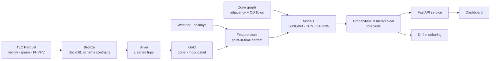

# NYC Taxi Demand at Scale

Forecasting hourly ride demand for every one of NYC's 263 taxi zones, from years of public
[TLC trip records](https://www.nyc.gov/site/tlc/about/tlc-trip-record-data.page) — hundreds of
millions of yellow, green and high-volume for-hire (Uber/Lyft) trips.

The goal is a complete, production-shaped forecasting system rather than a notebook:



**Highlights (in progress — see [ROADMAP.md](ROADMAP.md)):**
- Medallion lakehouse on DuckDB/Polars with data-quality contracts
- Leakage-safe feature store and rolling-origin backtesting
- Global gradient-boosted, temporal-convolutional and spatio-temporal graph neural network models
- Calibrated prediction intervals (conformal) and coherent zone → borough → city forecasts
- Served model with drift monitoring, containerised and tested in CI

## Quickstart

```bash
make setup          # creates .venv (Python 3.12) and installs the package
make check          # lint + tests
.venv/bin/taxidemand config show
```

## Getting the data

Raw files come straight from the TLC's official distribution and land under `data/raw/` with
Hive-style partitions, ready for the lakehouse layers:

```bash
.venv/bin/taxidemand ingest zones                                   # zone lookup + shapefile
.venv/bin/taxidemand ingest trips -s yellow -s green --start 2024-01 --end 2024-02
.venv/bin/taxidemand ingest verify                                  # re-hash against the manifest
```

```
data/raw/
├── manifest.json                       # url, sha256, bytes, row count per file
├── trips/service=yellow/month=2024-01/yellow_tripdata_2024-01.parquet
└── zones/{taxi_zone_lookup.csv, taxi_zones.zip, shapes/}
```

Downloads are parallel, streamed to a temporary file and moved into place atomically, retried
with exponential backoff on transient errors, and validated (Parquet footer and row count, CSV
columns, shapefile archive) before they are recorded. Re-running is idempotent; months the TLC has
not published yet are reported, not treated as failures.

## Bronze layer

Raw files are conformed to versioned **schema contracts** (one per service) and written as
partitioned Parquet with DuckDB. Contracts absorb the TLC's schema drift — column names that change
case across years, integers stored as doubles, columns added later — so every month unions cleanly.
Bronze never drops rows: each keeps a `source_row` lineage column and the row count is checked
against the raw file. Builds are incremental, keyed on the source checksum and contract fingerprint.

```bash
.venv/bin/taxidemand bronze build -s yellow -s green --start 2024-01 --end 2024-01
.venv/bin/taxidemand bronze quality --strict          # non-zero exit on warnings too
duckdb data/bronze/lakehouse.duckdb                   # views: yellow, green, fhvhv, trips, zones
```

Each build writes a data-quality report (`data/bronze/_quality/report.{md,json}`) covering row-count
reconciliation, schema drift, null checks, per-service rules (timestamps inside the month, dropoff
after pickup, valid zone codes, plausible distances and fares) and duplicate detection. A check
passes, warns within its threshold, or fails. On January 2024 (3,021,175 yellow + green trips) the
build takes under a second and the report is all warnings, no failures, with zero duplicates and
exact row-count matches; the largest finding is that 1.26% of yellow fares are negative (refunds
and disputes), which the silver layer will handle.

## Layout

```
configs/                pipeline configuration (validated with pydantic)
src/taxidemand/
├── config.py           typed settings
├── cli.py              `taxidemand` command
├── ingest/             sources, streaming downloader, manifest, pipeline
└── lakehouse/          schema contracts, bronze build, DuckDB catalog, quality report
tests/                  unit tests (offline; HTTP is mocked, data is synthetic)
```

## License

MIT
